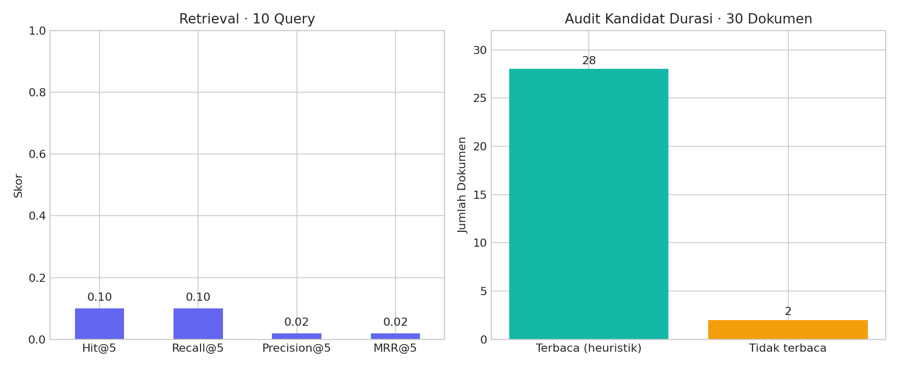

<div align="center">

# ⚖️ Case-Based Reasoning
### Pencarian Kasus Penggelapan · PN Jakarta Selatan


**30 dokumen · 5 notebook · TF-IDF · Cosine Similarity · Top-5 Retrieval**

*Menelusuri kasus terdahulu sebagai dasar eksperimen penalaran berbasis kasus.*

</div>

---

## Overview

Proyek mata kuliah **Penalaran Komputer** yang mengimplementasikan pencarian kasus serupa dan penggunaan kembali kandidat solusi dari korpus putusan penggelapan PN Jakarta Selatan.

Dokumen diubah menjadi representasi **TF-IDF**, diperingkat menggunakan **cosine similarity**, lalu kandidat durasi dari tetangga terdekat dirangkum melalui **majority voting**. Implementasi berfokus pada tahap **Retrieve** dan **Reuse**; tahap **Revise** dan **Retain** belum diimplementasikan.

## Highlights

- 📚 Basis kasus berisi 30 dokumen TXT yang tersedia lokal.
- 🔎 Pencarian top-k lengkap dengan nomor perkara dan skor kemiripan.
- 🧩 Satu modul Python untuk seluruh notebook dan eksekusi pipeline.
- ⏱️ Normalisasi kandidat durasi tahun/bulan ke satuan bulan.
- 📝 Audit ekstraksi dengan cuplikan teks dan status keterbacaan.
- 🎯 Evaluasi Hit@5, Recall@5, Precision@5, dan MRR@5.
- 🧪 Pengujian durasi, pelestarian data sumber, pengecualian kasus sendiri, query kosong, dan aturan voting.

## Dataset

| Komponen | Detail |
|---|---|
| Domain arsip | Putusan terkait penggelapan |
| Pengadilan menurut arsip proyek | Pengadilan Negeri Jakarta Selatan |
| Sumber menurut dokumentasi awal | Direktori Putusan Mahkamah Agung RI |
| Data tersedia | 30 TXT hasil ekstraksi/cleaning sebelumnya |
| Query evaluasi | 10 query dan pasangan target dari arsip tugas |
| Representasi | TF-IDF, maksimum 5.000 fitur |
| Default retrieval | Top-5 |

Berkas PDF asli dan tautan sumber per perkara tidak disertakan dalam arsip. TXT masih memiliki artefak OCR, termasuk nomor perkara `245 pid 20123 pn jkt sel`; nilai tersebut dipertahankan agar sesuai jejak data sumber. Penyebutan pasal pertama disimpan sebagai `pasal_mention`, bukan sebagai verifikasi pasal amar.

## Reasoning Pipeline

1. **Case Base** — memuat TXT secara terurut dan membersihkan teks tanpa menimpa `data/raw/`.
2. **Representation** — menyimpan ID stabil, nomor perkara, penyebutan pasal, teks, dan audit kandidat durasi.
3. **Retrieve** — memproyeksikan query ke indeks TF-IDF dan mengurutkan skor cosine tertinggi.
4. **Reuse** — voting kandidat durasi yang terbaca pada hasil top-k. Jika seri, kandidat tetangga berperingkat tertinggi dipilih.
5. **Evaluation** — menghitung metrik retrieval serta menyimpan hasil per query.

Seluruh dokumen diindeks untuk pencarian dalam koleksi ini. Query tanpa kosakata yang dikenal tidak menghasilkan kecocokan. Untuk query dari kasus dalam koleksi, `exclude_case_id` digunakan agar kasus itu sendiri tidak menjadi tetangga.

## Experiment Results

Evaluasi menggunakan **10 query bawaan arsip**, dengan satu target per query.

| Metrik | Skor |
|---|---:|
| Hit@5 | 0.10 |
| Recall@5 | 0.10 |
| Precision@5 | 0.02 |
| MRR@5 | 0.02 |

**1 dari 10 target ditemukan dalam top-5.** Hit@5 dan Recall@5 sama karena setiap query memiliki satu target. Precision@5 adalah jumlah target ditemukan dibagi lima slot; MRR@5 memakai kebalikan peringkat target, atau nol jika target tidak masuk top-5.



Pasangan query–target belum divalidasi oleh penilai relevansi independen. Hasil ini menggambarkan pencarian pada set query tersebut, bukan performa pada seluruh perkara atau akurasi prediksi putusan.

## Solution Reuse & Extraction Audit

Kandidat durasi diambil dari **penyebutan terakhir** frasa `pidana penjara selama`, lalu tahun dan bulan dikonversi ke bulan. **28 dari 30 dokumen** memiliki kandidat yang terbaca; sisanya ditandai `unparsed`.

Heuristik penyebutan terakhir tidak memastikan teks tersebut merupakan amar putusan. Semua kandidat terbaca berstatus `heuristic_requires_review`. Hasil voting adalah kandidat eksperimen yang belum diverifikasi, dan tidak diberi klaim akurasi durasi.

Label `actual_solution` dari query lama dipertahankan untuk jejak eksperimen, tetapi tidak digunakan sebagai ground truth durasi karena angka aslinya tidak memiliki satuan konsisten. Output lama berada di `data/legacy/`.

## Project Structure

| Path | Isi |
|---|---|
| `src/cbr.py` | Cleaning, ekstraksi, retrieval, reuse, evaluasi, dan entry point |
| `notebooks/01_case_base.ipynb` | Konstruksi basis kasus |
| `notebooks/02_case_representation.ipynb` | Representasi dan audit ekstraksi |
| `notebooks/03_case_retrieval.ipynb` | Pencarian kasus serupa |
| `notebooks/04_case_solution_reuse.ipynb` | Voting kandidat solusi |
| `notebooks/05_evaluation.ipynb` | Evaluasi retrieval |
| `data/raw/` | 30 dokumen sumber TXT |
| `data/processed/` | Basis kasus dan audit ekstraksi |
| `data/eval/` | Query bawaan dan metrik retrieval |
| `data/results/` | Peringkat per query dan contoh tetangga kasus |
| `data/legacy/` | Output asli untuk jejak eksperimen |
| `assets/` | Grafik ringkasan eksperimen |
| `tests/test_cbr.py` | Pengujian perilaku pipeline |

## Run Locally

Dari folder utama proyek:

```bash
python -m pip install -r requirements.txt
python -m src.cbr
```

Untuk eksplorasi notebook:

```bash
python -m jupyterlab
```

Jalankan notebook `01` sampai `05` secara berurutan. Notebook mendukung working directory folder utama maupun `notebooks/`.

## Python API

```python
from src.cbr import build_case_base, CaseRetriever

cases = build_case_base()
retriever = CaseRetriever(cases)

query = "terdakwa melakukan penggelapan uang perusahaan"
top_cases = retriever.retrieve(query, k=5)
candidate_months, neighbors = retriever.reuse(query, k=5)

print(top_cases[["case_id", "no_perkara", "similarity"]])
print("Kandidat durasi (bulan, belum diverifikasi):", candidate_months)
```

## Validation

```bash
python -m unittest discover -s tests -v
```

Kelima notebook telah dijalankan berurutan dan lima pengujian otomatis berhasil. Data sumber tetap identik setelah pipeline dijalankan.

## Authors

| Nama | NIM |
|---|---|
| Berliana Diva Rose | 202310370311128 |
| Hanisah Aufa Khalidah | 202310370311218 |

**Penalaran Komputer · Informatika · Universitas Muhammadiyah Malang · 2026**

## References

- Sumber korpus menurut arsip: [Direktori Putusan Mahkamah Agung RI](https://putusan3.mahkamahagung.go.id/).
- Implementasi representasi: [Scikit-learn — TfidfVectorizer](https://scikit-learn.org/stable/modules/generated/sklearn.feature_extraction.text.TfidfVectorizer.html).
- Perhitungan kemiripan: [Scikit-learn — Cosine Similarity](https://scikit-learn.org/stable/modules/generated/sklearn.metrics.pairwise.cosine_similarity.html).
